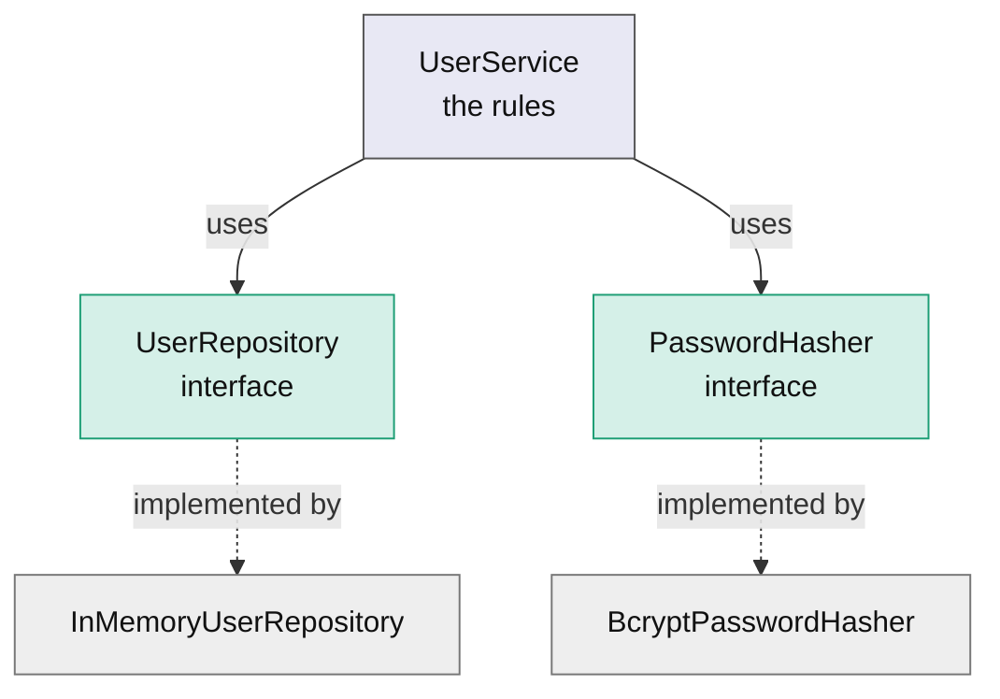

# Secure Service Module

A reusable Python library for user registration and credential verification. It hashes passwords with `bcrypt`, enforces a password policy, prevents duplicate registrations and logs significant authentication events. It is not a web application: it is the service layer an application would call.

## Requirements

- Python 3.11 or newer
- [Poetry](https://python-poetry.org/)

## Setup

```powershell
poetry install
poetry run pre-commit install
```

`requirements.txt` is also provided for pip users.

## Usage

```python
from secure_service_module.exceptions import InvalidPasswordError
from secure_service_module.hashers import BcryptPasswordHasher
from secure_service_module.repositories import InMemoryUserRepository
from secure_service_module.service import UserService

service = UserService(InMemoryUserRepository(), BcryptPasswordHasher())

service.create_user("aline", "Secret123!")
user = service.login("aline", "Secret123!")
print(user.username)

try:
    service.login("aline", "Wrong123!")
except InvalidPasswordError as error:
    print(error)
```

The library only creates log records. To see them, configure logging in your application:

```python
import logging

logging.basicConfig(level=logging.INFO)
```

## Architecture

`UserService` depends on two abstractions, never on concrete classes. Whoever builds the service chooses the implementations (dependency injection).



| Part | Responsibility |
|---|---|
| `UserService` | The rules: password policy, duplicate check, the order of the steps, logging |
| `UserRepository` | Finds and stores users (`search_user`, `save_user`) |
| `PasswordHasher` | Hashes passwords and checks them against a stored hash |
| `InMemoryUserRepository` | Keeps users in a dictionary keyed by username |
| `BcryptPasswordHasher` | Uses `bcrypt`, with a random salt for every hash |
| `User` | A dataclass holding `username` and `password_hash` |

### Why this design

- **Single responsibility:** the service holds the rules, while storage and hashing live in their own classes.
- **Dependency inversion:** the service can be used with any storage or hasher that follows the interfaces, so a database repository can replace the in-memory one without changing the service.
- **Testability:** `bcrypt` is deliberately slow, so the service tests use a fake hasher and a fake repository. Only the hasher's own tests call the real `bcrypt`.

### Files

```
src/secure_service_module/
    exceptions.py     custom exceptions
    models.py         the User dataclass
    interfaces.py     UserRepository and PasswordHasher
    service.py        UserService
    repositories.py   InMemoryUserRepository
    hashers.py        BcryptPasswordHasher
tests/                pytest suite
```

## Behaviour

| Action | Result |
|---|---|
| Register a new user with a valid password | The user is stored with a bcrypt hash, never the plain password |
| Register a taken username | `UserAlreadyExistsError` |
| Register with a weak password | `InvalidPasswordError` |
| Log in with a valid username and password | Returns the `User` |
| Log in with an unknown username | `UserNotFoundError` |
| Log in with a wrong password | `InvalidPasswordError` |

### Password policy

At least 8 characters, with at least one uppercase letter, one digit and one symbol.

### Logging

| Event | Level |
|---|---|
| Registration succeeded | `INFO` |
| Registration rejected (taken username) | `WARNING` |
| Login succeeded | `INFO` |
| Login failed (unknown user or wrong password) | `WARNING` |

Log lines contain the username and the cause. They never contain a password or a hash.

## Design decisions

- Users are identified by username. Two users with the same username are duplicates.
- The password hash is stored as a `str`. `BcryptPasswordHasher` handles the conversion to and from the bytes that `bcrypt` uses.
- Login failures for an unknown user and for a wrong password raise different exceptions, and the log records which one occurred.
- `InvalidPasswordError` is used for both a weak password at registration and a wrong password at login.
- Extra password rules beyond the policy above are left out on purpose, to keep the policy easy to test.

## Development

```powershell
poetry run black --check src tests
poetry run ruff check src tests
poetry run mypy src
poetry run pytest --cov=secure_service_module --cov-branch --cov-report=term-missing
```

The pre-commit hooks run Black, Ruff and mypy on every commit.

### Test-driven development

Every feature was built with the red-green-refactor cycle. The commit history shows each failing test (`test:`) followed by the smallest code that makes it pass (`feat:`).

### Coverage

100% statement and branch coverage. The full report is in `coverage.txt`.

## Git workflow

Git Flow: `main`, `develop`, and a `feature/...` branch for each piece of work, merged into `develop` through pull requests with merge commits, so the red-green history stays visible.
